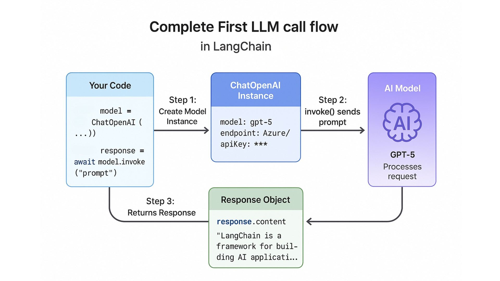

# Introduction to LangChain

In this lab, you'll learn what LangChain is, why it exists, explore its core concepts like models, prompts, and tools, and make your first LLM call using Google's Gemini API. By the end, you'll understand how LangChain provides a consistent interface across different AI providers.

## Course Setup

### Step 1: Install Python

You'll need **Python 3.10 or higher** to run LangChain v1 applications.

#### Check if Python is installed

```bash
python --version
# or
python3 --version
```

If you see Python 3.10 or higher, you're good! Skip to [Step 2](#step-2-clone-the-repository). If not:

#### Install Python

1. Visit [python.org](https://www.python.org/downloads/)
2. Download Python 3.10+ for your operating system
3. Follow the installation instructions (make sure to check "Add Python to PATH" on Windows)
4. Verify installation:

```bash
python --version  # Should show 3.10 or higher
pip --version     # Should show pip version
```

---

### Step 2: Clone the Repository

```bash
# Clone the course repository
git clone https://github.com/massimotisi/genai-engineering-labs-2025-2026

# Navigate to the project
cd genai-engineering-labs-2025-2026

# Create a virtual environment
python -m venv venv

# Activate the virtual environment
# On Mac/Linux:
source venv/bin/activate
# On Windows:
venv\Scripts\activate

# Install dependencies
pip install -r requirements.txt
```

This will install all required packages including:

- `langchain-google-genai` - Google Gemini model integration
- `langchain-core` - Core LangChain functionality
- `langchain` - Main LangChain package with additional utilities
- `python-dotenv` - Environment variable management for API keys

---

### Step 3: Create a Google AI API Key

Create a Gemini API key in [Google AI Studio](https://aistudio.google.com/apikey).
Copy the key and keep it private. Do not commit it to the repository.

### Step 4: Configure Environment Variables

#### Create `.env` file

**Mac, Linux, WSL on Windows:**

```bash
cp .env.example .env
```

**Windows Command Prompt:**

```bash
# Windows Command Prompt
copy .env.example .env

# Windows PowerShell
Copy-Item .env.example .env
```

#### Edit `.env` file

Open `.env` in your text editor and add your Google AI API key:

```bash
GOOGLE_API_KEY=your_google_ai_api_key
AI_MODEL=gemini-3.5-flash-lite
```

The `AI_MODEL` setting is optional; it defaults to `gemini-3.5-flash-lite`.

## Test Your Setup

Let's verify everything works!

### Run the test

Run the following command in your terminal from the root of the project:

```bash
python 01-introduction/scripts/test_setup.py
```

**Expected output:**

```bash
 Testing AI provider connection...

 SUCCESS! Your AI provider is working!
   Provider: Google Gemini API
   Model: gemini-3.5-flash-lite

Model response: Setup successful!

 You're ready to start the course!
```

If you see this, you're all set! If not, check the troubleshooting section below.

---

###  Setup Checklist

Before starting the course, make sure you have:

- [ ] Python 3.10+ installed
- [ ] Project cloned and virtual environment created
- [ ] Dependencies installed (`pip install -r requirements.txt`)
- [ ] Google AI API key created and set in `.env`
- [ ] `.env` file configured with your Google API key and Gemini model
- [ ] Test script runs successfully
- [ ] VS Code installed (optional but recommended)

---

## Learning Objectives

By the end of this lab, you'll be able to:

-  Understand what LangChain is and why it exists
-  Recognize common AI application patterns
-  Set up a development environment
-  Make your first LLM call using Google Gemini

---

##  What is LangChain?

LangChain is a **framework for building AI-powered applications** using Large Language Models (LLMs).

### The Problem It Solves

Without LangChain, you'd need to:
- Write different code for each LLM provider (OpenAI, Anthropic, Azure, etc.)
- Build your own prompt management system
- Create custom tools and function calling logic
- Implement memory and conversation handling from scratch
- Build agent systems without any structure

### The LangChain Solution

With LangChain, you get:

- **Provider abstraction** - Switch between OpenAI, Azure, Anthropic with minimal code changes
- **Prompt templates** - Reusable, testable prompts
- **Tools** - Extend AI with custom functions and APIs
- **Memory** - Built-in conversation history
- **Agents** - Decision-making AI that can use tools

---

##  Hands-On: Your First LLM Call

Let's make your first AI call using LangChain and Google Gemini!

### Example 1: Hello World

In this example, you'll create your first LangChain program that sends a simple message to an AI model and displays the response.

Let's walk through this step by step and then run the code:

#### **Step 1: Import what we need**

```python
from langchain_google_genai import ChatGoogleGenerativeAI
from dotenv import load_dotenv
import os

load_dotenv()
```

#### **Step 2: Create the AI model**

```python
model = ChatGoogleGenerativeAI(
    model=os.getenv("AI_MODEL", "gemini-3.5-flash-lite")
)
```

#### **Step 3: Ask the LLM a question**

```python
response = model.invoke("What is LangChain in one sentence?")
print(" AI Response:", response.text)
``` 

**Code**: [`code/01_hello_world.py`](./code/01_hello_world.py)
**Run**: `python 01-introduction/code/01_hello_world.py`

**This is the full example code**:

```python
from langchain_google_genai import ChatGoogleGenerativeAI
from dotenv import load_dotenv
import os

load_dotenv()

def main():
    print(" Hello LangChain!\n")

    # Create a chat model instance
    model = ChatGoogleGenerativeAI(
        model=os.getenv("AI_MODEL", "gemini-3.5-flash-lite")
    )

    # Make your first AI call!
    response = model.invoke("What is LangChain in one sentence?")

    print(" AI Response:", response.text)
    print("\n Success! You just made your first LangChain call!")

if __name__ == "__main__":
    main()
```

### Expected Output

When you run this example with `python 01-introduction/code/01_hello_world.py`, you'll see:

```bash
 Hello LangChain!

 AI Response: LangChain is a framework for building applications powered by large language models (LLMs).

 Success! You just made your first LangChain call!
```

### How It Works

#### **What's happening here?**
1. We import `ChatGoogleGenerativeAI` from the `langchain_google_genai` package
2. We create a model instance by instantiating `ChatGoogleGenerativeAI` with the model name
3. We call `invoke()` with a simple string prompt, which is the standard way of getting a response from an LLM in LangChain.
4. We get back a response with the LLM's answer



*The flow of your first LLM call - from creating a model instance to receiving a response*

#### **Understanding ChatGoogleGenerativeAI Configuration**:

The `ChatGoogleGenerativeAI` constructor takes the model name. It reads your API key from the `GOOGLE_API_KEY` environment variable.

The model name comes from `AI_MODEL` in your `.env` file.

**Why use environment variables?**
- `AI_MODEL` specifies which Gemini model to use
- `GOOGLE_API_KEY` provides authentication credentials.

Storing the key in `.env` keeps it out of your source code and version control.

---

##  Understanding Messages

LLMs work best with structured conversations. LangChain provides message types that separate system instructions (`SystemMessage`) from user input (`HumanMessage`), giving you precise control over the AI's personality and behavior.

### Example 2: Message Types

Let's see how to use SystemMessage and HumanMessage to control AI behavior and set the tone of responses. 

**Code**: [`code/02_message_types.py`](./code/02_message_types.py)
**Run**: `python 01-introduction/code/02_message_types.py`

**This is the full example code**:

```python
from langchain_google_genai import ChatGoogleGenerativeAI
from langchain_core.messages import HumanMessage, SystemMessage
from dotenv import load_dotenv
import os

load_dotenv()

def main():
    print(" Understanding Message Types\n")

    model = ChatGoogleGenerativeAI(
        model=os.getenv("AI_MODEL", "gemini-3.5-flash-lite")
    )

    # Using structured messages for better control
    messages = [
        SystemMessage(content="You are a helpful AI assistant who explains things to a 10-year-old."),
        HumanMessage(content="Explain quantum computing."),
    ]

    response = model.invoke(messages)

    print(" AI Response:\n")
    print(response.text)
    print("\n Notice how the SystemMessage influenced the response style!")

if __name__ == "__main__":
    main()
```

### Expected Output

When you run this example with `python 01-introduction/code/02_message_types.py`, you'll see something similar to:

```bash
 Understanding Message Types

 AI Response:

Quantum computing is like having a super-fast magic box that can try many different solutions to a puzzle at the same time! While regular computers look at one answer at a time, quantum computers can explore lots of possibilities all at once, which helps them solve really hard problems much faster.

 Notice how the SystemMessage influenced the response style!
```

### How It Works

#### **Message Types**:
- **SystemMessage**: Sets the AI's behavior and personality
- **HumanMessage**: User input
- **AIMessage**: The AI's responses (usually added automatically)

#### **What's happening**:
1. The SystemMessage tells the AI to explain things simply (like to a beginner)
2. The HumanMessage contains the user's question about quantum computing
3. The AI crafts a response that matches the system instruction (simple explanation)
4. Because we set the personality in the SystemMessage, the response is age-appropriate and clear.

#### **Why use messages instead of strings?**
- Better control over AI behavior
- Maintains conversation context
- More powerful and flexible

---

##  Comparing Models

Google AI provides multiple Gemini models. Let's compare them!

**You're building an app and need to choose which model to use.** Compare `gemini-3.8-flash` with `gemini-3.5-flash-lite` for capability, speed, and cost.

Think of it like choosing between calculators: a scientific calculator handles complex equations but takes more time and resources, while a basic calculator is fast and efficient for simple math. The best way to decide is to test both with your actual prompts and compare their responses.

### Example 3: Model Comparison

Let's see how to programmatically compare different models side-by-side.

**Code**: [`code/03_model_comparison.py`](./code/03_model_comparison.py) 
**Run**: `python 01-introduction/code/03_model_comparison.py`

**This is the full example code**:

```python
from langchain_google_genai import ChatGoogleGenerativeAI
from dotenv import load_dotenv
import os
import time

load_dotenv()

def compare_models():
    print(" Comparing AI Models\n")

    prompt = "Explain recursion in programming in one sentence."
    models = ["gemini-3.8-flash", "gemini-3.5-flash-lite"]

    for model_name in models:
        print(f"\n Testing: {model_name}")
        print("─" * 50)

        model = ChatGoogleGenerativeAI(model=model_name)

        start_time = time.time()
        response = model.invoke(prompt)
        duration = (time.time() - start_time) * 1000

        print(f"Response: {response.text}")
        print(f"️  Time: {duration:.0f}ms")

    print("\n Comparison complete!")
    print("\n Key Observations:")
    print("   - gemini-3.8-flash is Google's higher-capability Flash model")
    print("   - gemini-3.5-flash-lite is optimized for speed and efficiency")
    print("   - Choose based on your needs: speed vs. capability")

if __name__ == "__main__":
    compare_models()
```

### Expected Output

When you run this example with `python 01-introduction/code/03_model_comparison.py`, you'll see:

```
 Comparing AI Models


 Testing: gemini-3.8-flash
──────────────────────────────────────────────────
Response: Recursion in programming is a technique where a function calls itself to solve smaller instances of the same problem until it reaches a base case.
️  Time: 2134ms

 Testing: gemini-3.5-flash-lite
──────────────────────────────────────────────────
Response: Recursion is when a function calls itself to solve a problem by breaking it down into smaller, similar sub-problems.
️  Time: 1845ms

 Comparison complete!

 Key Observations:
   - gemini-3.8-flash is Google's higher-capability Flash model
   - gemini-3.5-flash-lite is optimized for speed and efficiency
   - Choose based on your needs: speed vs. capability
```

> **Note**: Your LLM's response may vary slightly from this example, and timing will depend on your network connection and API load.

### How It Works

#### **What's happening**:
1. We define a single prompt asking about recursion
2. We loop through two different Gemini models
3. For each model, we create a new `ChatGoogleGenerativeAI` instance with that model name
4. We invoke the same prompt on each model
5. We display the response from each model for comparison

#### **What you'll notice**:
- Different models have different response styles
- `gemini-3.8-flash` is a higher-capability model
- `gemini-3.5-flash-lite` is designed for speed and efficiency
- Both answers are correct, just expressed differently

---

##  Real-World Applications

#### **Where you'll see these concepts in action:**

- **Chatbots & Virtual Assistants**: Use models, memory, and system messages to maintain helpful conversations
- **Content Generation Tools**: Use prompts and templates to create consistent, high-quality content
- **Code Assistants**: Use tools and agents to search documentation, run tests, and suggest improvements
- **Customer Support Systems**: Use message types to set tone and memory to maintain context across conversations

---

##  Key Takeaways

Let's review what you learned:

- **LangChain is an abstraction layer** - It provides a consistent interface across different LLM providers
- **Messages have types** - SystemMessage, HumanMessage, and AIMessage serve different purposes

---

##  Assignment

Complete the challenges in [assignment.md](./assignment.md)!

The assignment includes:
1. **System Prompts Experiment** - Learn how SystemMessage affects AI behavior
2. **Model Performance Comparison** (Bonus) - Compare multiple models on the same task

---

##  Additional Resources

- [LangChain Python Documentation](https://python.langchain.com/)
- [Google AI Studio](https://aistudio.google.com/)
- [Chat Models Documentation](https://python.langchain.com/docs/integrations/chat/)
